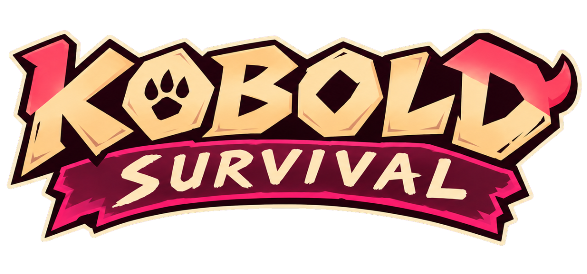

<h1 align="center"></h1>

<p align="center"><a href="https://github.com/loremipsumdemo/koboldsurvival/actions/workflows/build.yml"></a></p>

Kobold Survival is a 3D real-time colony and squad game for Windows, written in C++17 with SDL3 and OpenGL 3.3. You lead a faction of kobolds. You command its military directly, citizens work your camp from task lists you set, and Fortified units guard its Perimeter. Fifteen other factions, wild animals and bosses share a procedurally generated world.

## Building

You need:

- Windows, with a graphics card and driver that support OpenGL 3.3
- Visual Studio 2022 or later with *Desktop development with C++* (MSVC, CMake and Ninja)
- [vcpkg](https://github.com/microsoft/vcpkg)

From an *x64 Native Tools Command Prompt*, with vcpkg in `C:\vcpkg` (change the path to match yours):

```bat
cmake -G Ninja -B out/build/x64-Release -DCMAKE_BUILD_TYPE=RelWithDebInfo -DCMAKE_TOOLCHAIN_FILE=C:/vcpkg/scripts/buildsystems/vcpkg.cmake
cmake --build out/build/x64-Release
```

The first configure builds SDL3, SDL3_image, SDL3_ttf and GLEW through vcpkg ([vcpkg.json](vcpkg.json)) and fetches tinygltf and miniaudio, so it takes a while. After `vcpkg integrate install`, Visual Studio can also open the folder and build the configurations in [CMakeSettings.json](CMakeSettings.json) (`x64-Debug`, `x64-Release`, `x64-Profile`).

Run `out/build/x64-Release/koboldsurvival.exe`. Settings, saves and the debug log go to `%APPDATA%\KoboldSurvival\`. Maps and screenshots are kept beside the exe.

## Controls

| Input | Action |
| --- | --- |
| W A S D or arrow keys | Move the camera (hold Shift to move faster) |
| Middle mouse drag | Rotate the camera |
| Mouse wheel | Zoom |
| Left click, or drag a box | Select units. Shift or Alt adds to the selection |
| Drag a box over ground items | The selected units pick them up (if the box holds no unselected units) |
| Right click | Move the selected units, or open the actions for what is under the pointer |
| Hold right mouse | The selected units keep walking toward the pointer |
| Alt + right mouse drag | Place two or more selected units around where the drag starts; the drag sets the size |
| Alt + 1 / 2 / 3 / 4, or the Form button | Form a line, circle, rectangle or wedge |
| Alt + 5 | Switch between tight and loose formations |
| Numpad 1 to 9 | Select that squad. Shift adds it; a second press moves the camera to it |
| Ctrl + Numpad 1 to 9 | Move the selected units into that squad |
| Numpad 0 | Select your military unit nearest the camera's centre |
| Hold Shift while moving a stack | Choose how many to move |
| Hold Alt | Show the names of items on the ground |
| Q / E, Z | Show the floor below or above; Z goes back to Auto, which follows the camera's unit |
| R | Turn stairs, a Perimeter piece or a blueprint while placing it |
| Space | Pause or resume |
| M | Open or close the world map |
| Esc | Go back, or open the game menu |
| F12 | Take a screenshot |

## Making maps and levels

From the title screen:

1. **World Generation** makes a map from one of seven styles, sliders for the land, relief, climate and forests, and a visual theme. The map file holds only this recipe (seed and settings), and the ground is rebuilt from it. Maps can be 512 to 65536 tiles wide; the game is made and tested for up to 8192.
2. **Map Editor** (on the World Generation screen) sculpts the ground (raise, lower, smooth, flatten, roughen) and paints ground textures with brushes. `[` and `]` change the brush size. Its edits are saved beside the map as `<name>.edits`.
3. **Continue to Level Editor** places the player spawn, NPC faction spawns, units, mobs, props and items. Left click places, right click erases, and Q and E turn what you place. Tab switches between the editor's interface and the game's.

Both editors save with Ctrl+S and undo with Ctrl+Z.

**Scenario Editor** sets how a new game starts (unit counts, camps, supplies, standings and faction rules). **Building Blueprints** draws building plans, which NPC factions build and you can lay out from the Build tab. New Game then asks for a map, an optional level, a scenario and your party.

These files are saved in the `MAP` folder beside the exe. Their formats are described in [MAP/README.md](MAP/README.md) and the READMEs in its subfolders.

## Development

- [CLAUDE.md](CLAUDE.md) describes the architecture (simulation library, ECS, rendering, file formats) and the project's conventions.
- Items, props, mobs, recipes, factions and the rest of the content are plain-text tables in [data](data), and each table's header comment explains its format. The game reads `data/` only through `data.pak`, which every build repacks, so rebuild after any change there.
- Everything the player reads is a key in [data/language](data/language): `language_en.txt` (the base) and `language_zh-CN.txt`. Show text with `lang("KEY")` or `langf("KEY", { ... })` (which fills in `{0}`, `{1}`), never as English in code. Every language file keeps the same keys in the same order under the same `#` headers. `python tools/sort_language.py . --write` files new keys under their headers.
- The Python scripts in [tools](tools) generate the prop models, item sprites, icons, emotes, building textures, sounds and extra unit animation clips. They need Python 3 with Pillow, plus NumPy for the sounds and clips, and ffmpeg for the sounds. Each script overwrites every asset it lists, including hand-made replacements. Read its docstring first, and pass the names to regenerate when it accepts them.
- Saves and levels refer to content by its key or id, so never rename or reuse one. When a save line changes, raise `SAVE_VERSION` and add a step to [src/save_migrate.cpp](src/save_migrate.cpp).
- There are no automated tests. CI builds every push and pull request on Windows, and changes are checked by playing.

Layout: `src` (C++ source), `data` (content, models, art, fonts, text), `MAP` (the shipped map and NPC building plans), `BGM` and `SFX` (music and sounds), `tools` (asset scripts and build helpers).

## License

No license has been chosen yet.
